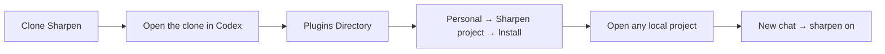

# Sharpen for Codex: install and use

Follow these steps once to install Sharpen, then use it from local project chats in Codex.



## 1. Clone the Sharpen repository

Open Terminal (macOS/Linux) or PowerShell (Windows) and run:

```sh
git clone https://github.com/melthond/sharpen.git
```

Keep the cloned `sharpen` folder on your computer. Codex uses it to find Sharpen's local marketplace.

## 2. Open Sharpen and find its marketplace

1. Open the **sharpen** folder in the Codex desktop app.
2. If Codex asks whether to trust the folder, choose **Trust**.
3. Restart Codex so it can discover the marketplace included in the repository.
4. Open **Plugins Directory**.
5. Choose **Personal**, then choose **Sharpen project**. This is the local marketplace supplied by the cloned repository.
6. Select **Sharpen**, then choose **Install**. Review the plugin details and the listed skills before installing.
7. If Codex asks to trust or enable Sharpen's hooks, review and allow them. They run locally and need Node.js 18 or later.

The plugin details show Sharpen's included skills. They are also listed below with examples of how to use them.

## 3. Turn Sharpen on in a project

1. Open the local project you want to work on in Codex.
2. Start a **new local chat** in that project.
3. Send `sharpen on`.
4. Send `sharpen` to confirm it is on.
5. Try `summarize the purpose of this repository`. A review should appear before the request runs. Choose **Run my original** to complete this check without changing files.

The plugin is installed once for your Codex account and can be used in other local projects. A project's own Codex settings can disable it; if Sharpen does not appear in a project, open that project's plugin settings and enable Sharpen. The `sharpen on` setting is user-level and carries across local chats.

## Use a Sharpen skill

In a local chat, type `$` followed by a skill name. For example:

```text
$sharpen-prompt make this request clear and specific
```

| Skill | Use it to… |
|---|---|
| `$sharpen-help` | See the quick reference. |
| `$sharpen-prompt` | Rewrite a prompt without running it. |
| `$sharpen-decompile` | Improve or adapt a prompt you already have. |
| `$sharpen-plan` | Turn a large project into phases and prompts. |
| `$sharpen-interview` | Decide details for a fuzzy feature, one question at a time. |
| `$sharpen-split` | Break a large request into ordered smaller tasks. |
| `$sharpen-handoff` | Prepare a conversation handoff for a fresh chat. |
| `$sharpen-review` | Get feedback on your recent prompting. |
| `$sharpen-save` | Save a reusable prompt as a project skill. |
| `$sharpen-audit` | Find missing project instructions that would help an agent. |

These skills are available separately from automatic prompt reviews. Turn reviews on with `sharpen on`; use a skill by invoking its `$sharpen-…` name.

## Quick controls

| Send this | To… |
|---|---|
| `sharpen on` | Turn automatic prompt reviews on. |
| `sharpen off` | Turn them off. |
| `sharpen` | Check the current status. |

## Update or get help

After pulling new changes into your Sharpen clone, refresh or reinstall **Sharpen** from **Personal → Sharpen project** in the Plugins Directory, then restart Codex. Installed plugins use a cached copy and do not update when the clone changes.

For more setup details, see the [main README](../README.md#codex-desktop) or the [official Codex plugin guide](https://developers.openai.com/plugins/build/plugins).
