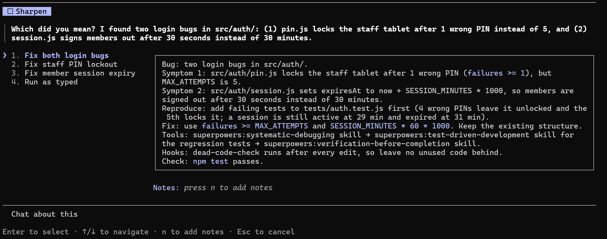

<h1 align="center">Sharpen</h1>

<p align="center">
  <em>You type “fix the login thing.” It knows which one.</em>
</p>

<p align="center">
  
  
  
  
  
  
</p>

<p align="center">
  A Claude Code plugin that rewrites your plain prompt into the prompt you meant, using your conversation, your code, and your installed skills, agents, MCP servers and hooks. It shows you that prompt before anything runs.
</p>

<p align="center">
  
</p>

---

You know her. The colleague who never starts the wrong thing. You say "can you fix the login thing?" and she doesn't open an editor. She asks: *"The PIN lockout from this morning, or the Google sign-in that's been open since Tuesday?"* One question, and the right one. Then she writes the task down properly, with the file, the test and the tools to use, and hands it back for you to sign off.

Sharpen puts her inside your AI agent.

## Highlights

- **Every prompt gets engineered:** where to look, what's already decided, how to tell it's done.
- **Built from your real setup.** It uses your conversation, your code, and the skills, agents, MCP servers and hooks you have installed. Hooks are read for Claude, which can't see them otherwise.
- **Nothing runs until you send it.** A review card offers **Send it**, **Run my original**, or your changes, and the prompt is also copied to your clipboard.
- **It asks only when it must.** "Which did you mean?" appears only when two readings would lead to different work.
- **Eight companion skills:** sharpen a prompt for another AI, hand off to a fresh session, split a big task, coach your prompting, and more.
- **Zero dependencies, nothing leaves your machine.** No API calls and no telemetry.

**Contents:** [Install](#install) · [Before / after](#before--after) · [How it works](#how-it-works) · [Review card](#the-review-card) · [Skills](#skills) · [Commands](#commands) · [Status badge](#status-badge) · [Numbers](#numbers) · [Privacy](#privacy) · [Updating](#updating) · [Troubleshooting](#troubleshooting) · [FAQ](#faq) · [Contributing](#contributing)

## Install

**Requires** Claude Code with plugin support, and Node.js 18 or later, which runs the hooks.

In Claude Code, as two separate prompts:

```
/plugin marketplace add ardfaiyaz/sharpen
```
```
/plugin install sharpen@sharpen
```

Restart Claude Code, then:

```
/sharpen on
```

That was it. Send it a vague prompt and watch.

Sharpen is **off by default**, and stays on or off across sessions until you change it. Only install it from `ardfaiyaz/sharpen` on GitHub. It's plain JavaScript and Markdown and never ships binaries. A copy that does isn't the real one.

## Before / after

You type:

```
fix the clipboard so it clears after 30 seconds
```

**Without Sharpen,** the agent starts from those ten words. Whether it also finds the test, the hint on screen and the spec that all say 60 depends on what it happens to look at.

**With Sharpen,** this card comes back first (a real run):

```
Sharpened prompt (fill-in):
  Change the clipboard clear for copied keys from 60 to 30 seconds.
  Where: apps/admin/src/lib/clipboard.ts:2 (HOLD_MS = 60_000 → 30_000)
  Also update: generate.tsx:181 (hint text), clipboard.test.ts, PRD FR-19 (:269), checklist US-020
  Keep: the "leave it alone if something else was copied" rule
  Hooks: dead-code-check runs after every edit
  Check: npx vitest run apps/admin/src/lib/clipboard.test.ts passes

  ❯ Send it (Recommended)      Run my original      [type your changes]
```

One click, and the agent works on *that*.

## How it works

<p align="center">
  
</p>

**1. Gate.** Sharpen decides what kind of prompt it is. It only asks *which one* when two readings would lead to different work. Otherwise it writes the one engineered prompt.

<p align="center">
  
</p>

**2. Gather, fast.** It checks the conversation first, then does a few quick searches of the code: at most 3, or 6 when a prompt is ambiguous and nothing solid turned up. Then it checks your setup: the skills, agents, MCP tools and plugin commands Claude Code lists, plus a summary of your hooks and enabled plugins that Sharpen builds at session start.

**3. Engineer it.** Sharpen classifies the intent (bug, feature, refactor, performance, question, review, explore, ops) and fills in what that kind of request needs. Three lines tie it to *your* environment:

| Line | What it carries | Example |
|---|---|---|
| `Decided:` | Earlier decisions from the conversation that still bind | `Decided: keep the counter in pin.ts, no new dependency` |
| `Tools:` | Which installed tools to use, in order. Your project's own agents and skills come first | `Tools: Explore agent → systematic-debugging skill → test-automator agent` |
| `Hooks:` | Hooks that will run during the work and change how to do it. They're never called | `Hooks: dead-code-check runs after every edit` |

<details>
<summary>What each kind of request spells out</summary>

| Intent | What the engineered prompt spells out |
|---|---|
| **Bug** | Symptom · Where · Reproduce (failing test) · Fix · Check |
| **Feature** | What and for whom · Where it plugs in · Existing pattern to follow · Done when · Out of scope |
| **Refactor** | Target · Behaviour that must not change · Tests stay green · Scope limit |
| **Performance** | Metric · Measure the baseline first · Target · Where |
| **Question** | What to explain · Depth · Read-only |
| **Review** | What · Focus · Report only |
| **Explore** | Keep it open · No edits · Scope |
| **Ops** (git, deploy, config) | Exact action · Target · Ask before anything irreversible |

</details>

Before showing the prompt, Sharpen checks that your meaning is unchanged, there's a finish line, the scope is stated, every name is real, and there's no filler. Anything it couldn't find says `(not found)`.

**4. Review card, then run.** Nothing runs until you answer the card.

## The review card

<p align="center">
  
</p>

<p align="center"><sub>A real card: <code>fix the login thing</code> in a small demo app with two login bugs.</sub></p>

| You choose | What happens |
|---|---|
| **Send it** | Claude works on exactly the engineered prompt |
| **Run my original** | Claude works on what you typed, unchanged |
| **Type your changes** ("make it 15 seconds") | You get an updated card |
| **Esc, then Ctrl+V** | The engineered prompt is already on your clipboard. Paste it, edit any word, and send it. Sharpen won't sharpen it again |

Why a card and not your prompt swapped in place? Claude Code doesn't allow that. Its hook docs say a plugin can't replace your prompt, fill the input box, or send a message as you. The card plus the clipboard is the closest you can get.

## Skills

Eight companion skills. They work whether Sharpen is on or off.

| Skill | What it does |
|---|---|
| `/sharpen:sharpen-prompt <prompt>` | Writes the engineered prompt and **hands it back without running it**. Say "for ChatGPT" or "for a ticket" to get a version that stands on its own. |
| `/sharpen:sharpen-review` | Coaches **your** prompting: what each recent prompt left out, what that cost, and the one habit that would help most. |
| `/sharpen:sharpen-audit` | Finds what an agent can't see from your code (test commands, unwritten rules, which folder owns what), with paste-ready lines for `CLAUDE.md`. |
| `/sharpen:sharpen-handoff` | Turns the whole conversation into **one starting prompt for a fresh session**, including what failed and why. |
| `/sharpen:sharpen-split <request>` | Splits a big request into **small, ordered prompts**, grouped into waves you can run in parallel. |
| `/sharpen:sharpen-save [name]` | Turns a prompt you keep typing into a **project slash command**. Shows you the file first; never overwrites. |
| `/sharpen:sharpen-interview <feature>` | Asks about a fuzzy feature **one question at a time**, then writes `SPEC.md`. |
| `/sharpen:sharpen-help` | A quick reference card. |

## Commands

| Command | What it does |
|---|---|
| `/sharpen on` | Turn Sharpen on. Every prompt gets an engineered version on a review card. |
| `/sharpen off` | Turn it off. |
| `/sharpen` | Show whether it's on. |
| `raw: <prompt>` | Skip Sharpen for this one prompt. |
| `sharpen: <prompt>` | Always get options for this prompt, even if it's clear or Sharpen is off. |

Other slash commands are never touched. `/sharpen:sharpen on` works too.

## Status badge

While Sharpen is on, a red badge in the status bar shows where your latest prompt stands:

| Badge | Meaning |
|---|---|
| `[SHARPEN - CLEAR - READY]` | Clear prompt; the review card is waiting |
| `[SHARPEN - FILL-IN - READY]` | One obvious meaning; the review card is waiting |
| `[SHARPEN - AMBIGUOUS - READY]` | Several meanings; the options are waiting |
| `[SHARPEN - … - SENT]` | You answered the card, and the prompt is running |
| `[SHARPEN - SENT]` | You pasted a sharpened prompt back and sent it |
| `[SHARPEN - RAW]` | You skipped Sharpen with `raw:` |

It reads the end of the session transcript that Claude Code hands to the status line, so it costs no tokens and stores nothing. It sets itself up on your first `/sharpen on`. If you already have a status line, it **never overwrites it**: Claude offers once to chain the badge after yours.

## Numbers

Sharpen was tested on a real Tauri + React + Firebase codebase, with editing blocked so nothing could change. The prompts went through `claude -p` with the plugin loaded, and every answer was read by hand:

| Prompt type | Prompts | Result |
|---|---|---|
| Clear (`explain what apps/admin/src/api/client.ts exports`) | 5 | 5/5 recognized as clear, with the request left as asked |
| Vague (`make it faster`, `clean this up`, `it's broken again`…) | 5 | 5/5 got options naming real files and the project's own agents |
| `raw:` and `sharpen:` prefixes | 2 | 2/2 after one tuning round |

That full set ran on the first release. Later releases were spot-checked live on the same codebase. Those runs showed `Tools:` and `Hooks:` lines drawn from the real setup, and Claude waiting for the card instead of editing. There are also 92 automated tests. The full set, and how to re-run it: [`tests/eval/prompts.md`](tests/eval/prompts.md).

## Privacy

- **Nothing leaves your machine.** No API calls, no telemetry, no webhooks. The thinking is done by the agent you're already using.
- **Your prompts are never logged.** The hooks read the prompt, decide, and exit.
- **Your settings are read, never changed.** The hook summary keeps only each hook's event and script *name*, never its arguments, which can hold tokens.
- **Your clipboard is used.** When a review card appears, the engineered prompt replaces what's on your clipboard.
- **Files written:** `~/.config/sharpen/state.json`, `last-sharpened.txt` (so a pasted copy isn't sharpened twice), and the badge script. `~/.claude/settings.json` is only edited to add the badge when you have no status line yet.

## Updating

```
/plugin marketplace update sharpen
/plugin update sharpen@sharpen
```

Then **restart Claude Code**. Plugins load when a session starts, so a session that was already open keeps the old version until you restart it.

## Troubleshooting

<details>
<summary>Claude runs the prompt straight away instead of showing the card</summary>

That session is running an older version. The review card arrived in v1.6.0. Restart Claude Code after updating, then check with `/sharpen:sharpen-help`. If it still skips the card, open an issue with the prompt you used.
</details>

<details>
<summary>The badge doesn't show</summary>

If you already had a status line, Sharpen didn't touch it. Add `node "~/.config/sharpen/sharpen-statusline.js"` after your existing status line command. The badge only shows while Sharpen is on.
</details>

<details>
<summary>Nothing lands on the clipboard (Linux)</summary>

Sharpen uses `wl-copy`, `xclip` or `xsel`, whichever is installed. Install one of them. Windows (`clip`) and macOS (`pbcopy`) work out of the box.
</details>

## FAQ

<details>
<summary>Won't this slow me down?</summary>

By one click per prompt: **Send it**. In exchange, you see exactly what will run before it runs, and a wrong guess costs you one look instead of a wrong change. For a prompt you're sure about, start it with `raw:`.
</details>

<details>
<summary>Does it cost extra tokens?</summary>

A little. The method (~6 KB) and your setup summary load once per session, plus one short line per prompt. In return, the work starts from a prompt with the right files, tools and finish line, which usually saves the turn a vague prompt would have cost.
</details>

<details>
<summary>Doesn't rewriting a clear prompt make it worse?</summary>

It can, when the rewrite changes what you asked for. That's why, for a clear prompt, Sharpen only *adds* context and never rewords your request.
</details>

<details>
<summary>Does it know my skills, agents, MCP servers and hooks?</summary>

Skills, agents, MCP tools and plugin commands: yes, from what Claude Code lists. Hooks: yes, because Sharpen reads them from your settings and plugins at session start. Claude can't see them otherwise.
</details>

<details>
<summary>Can it put the prompt straight into my input box?</summary>

No. Claude Code doesn't let a plugin fill the input box or send a message as you. The engineered prompt goes on your clipboard instead: press Esc, then Ctrl+V.
</details>

<details>
<summary>Does it work in Codex, Gemini CLI, Copilot CLI, Cursor…?</summary>

Not yet. Claude Code comes first. Other agents will reuse the same `SKILL.md`, and only agents that let a plugin run on every prompt will get it, so `/sharpen off` really turns it off.
</details>

<details>
<summary>Can it read my mind?</summary>

No. It reads your conversation, which is the next best thing, and more reliable.
</details>

<details>
<summary>Why "sharpen"?</summary>

A blunt prompt still cuts, just not where you meant.
</details>

## Contributing

Bug fixes are welcome. A change to the method needs an eval that compares no Sharpen, `main` and your branch, because a harmless-looking rewording can make Sharpen worse. Everything is in **[CONTRIBUTING.md](CONTRIBUTING.md)**.

```bash
git clone https://github.com/ardfaiyaz/sharpen
cd sharpen
npm test                 # zero dependencies
claude --plugin-dir .    # try your checkout without installing it
```

<details>
<summary>What's in this repo</summary>

Sharpen is one prompt: [`skills/sharpen/SKILL.md`](skills/sharpen/SKILL.md). Everything else loads it at the right moment, with the right context:

| File | Job |
|---|---|
| `hooks/sharpen-prompt.js` | `UserPromptSubmit`: handles `/sharpen on\|off`, recognizes pasted prompts, and reminds Claude of the step on every prompt |
| `hooks/sharpen-session.js` | `SessionStart`: loads the method and your setup summary |
| `hooks/sharpen-env.js` | The setup summary: your hooks (names only) and enabled plugins |
| `hooks/sharpen-clipboard.js` | `PreToolUse` on the review card: copies the engineered prompt to your clipboard |
| `hooks/sharpen-core.js` | The decision table: pure functions, fully tested |
| `hooks/sharpen-statusline.js` | The red badge, with the verdict read from the transcript |
| `skills/` | The method and the eight companion skills |
| `scripts/build-diagrams.js` | Builds the README diagrams from `assets/src/` |
| `docs/` | The design, the plan and the research behind the method |

The hooks never block a prompt. On any error they exit quietly, and if stdin never closes (a known Windows quirk) they give up after 3 seconds.
</details>

## License

[MIT](LICENSE.md). Sharp, short, and yours to use.

The diagrams use the hand-drawn xkcd Script font, which has its own license: see [`assets/fonts/LICENSE.md`](assets/fonts/LICENSE.md).

## Star History

<a href="https://www.star-history.com/#ardfaiyaz/sharpen&Date">
  
</a>
